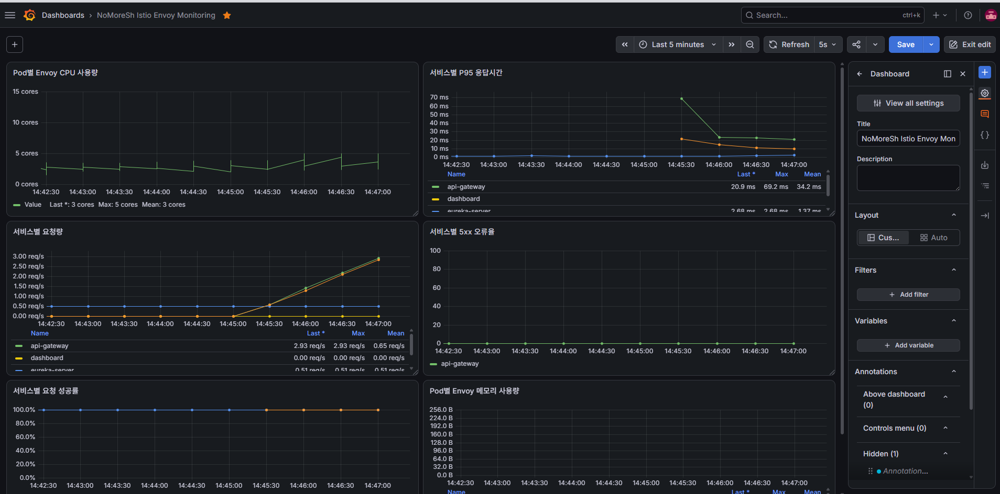

## 1. Monitoring Namespace 생성

Prometheus, Grafana 등을 설치할 namespace를 생성합니다.

```bash
kubectl create namespace monitoring
```

이미 존재하면 에러가 날 수 있지만 무시해도 됩니다.

확인:

```bash
kubectl get ns
```

---

## 2. Prometheus Community Helm Repository 추가

```bash
helm repo add prometheus-community https://prometheus-community.github.io/helm-charts
helm repo update
```

---

## 3. kube-prometheus-stack 설치

`kube-prometheus-stack`은 아래 구성 요소들을 한 번에 설치해주는 Helm Chart입니다.

- Prometheus
- Grafana
- Alertmanager
- node-exporter
- kube-state-metrics
- Prometheus Operator

설치 명령어:

```bash
helm install kube-prometheus-stack prometheus-community/kube-prometheus-stack \
  -n monitoring
```

설치 후 정상 출력 예시:

```text
NAME: kube-prometheus-stack
LAST DEPLOYED: Wed Jun 17 02:18:15 2026
NAMESPACE: monitoring
STATUS: deployed
REVISION: 1
TEST SUITE: None
```

---

## 4. Pod 상태 확인

```bash
kubectl get pods -n monitoring
```

정상 예시:

```text
NAME                                                        READY   STATUS    RESTARTS   AGE
alertmanager-kube-prometheus-stack-alertmanager-0           2/2     Running   0          ...
kube-prometheus-stack-grafana-xxxxx                         3/3     Running   0          ...
kube-prometheus-stack-kube-state-metrics-xxxxx              1/1     Running   0          ...
kube-prometheus-stack-operator-xxxxx                        1/1     Running   0          ...
kube-prometheus-stack-prometheus-node-exporter-xxxxx         1/1     Running   0          ...
prometheus-kube-prometheus-stack-prometheus-0               2/2     Running   0          ...
```

Grafana가 처음에는 아래처럼 보일 수 있습니다.

```text
kube-prometheus-stack-grafana-xxxxx   0/3   ContainerCreating
```

이 경우 몇 분 기다린 뒤 다시 확인합니다.

```bash
kubectl get pods -n monitoring
```

계속 `ContainerCreating` 상태라면 원인을 확인합니다.

```bash
kubectl describe pod -n monitoring -l app.kubernetes.io/name=grafana
```

---

## 5. Service 상태 확인

```bash
kubectl get svc -n monitoring
```

예상 결과:

```text
NAME                                             TYPE        CLUSTER-IP       EXTERNAL-IP   PORT(S)
alertmanager-operated                            ClusterIP   None             <none>        9093/TCP,9094/TCP,9094/UDP
kube-prometheus-stack-alertmanager               ClusterIP   ...              <none>        9093/TCP,8080/TCP
kube-prometheus-stack-grafana                    ClusterIP   ...              <none>        80/TCP
kube-prometheus-stack-kube-state-metrics         ClusterIP   ...              <none>        8080/TCP
kube-prometheus-stack-operator                   ClusterIP   ...              <none>        443/TCP
kube-prometheus-stack-prometheus                 ClusterIP   ...              <none>        9090/TCP,8080/TCP
kube-prometheus-stack-prometheus-node-exporter   ClusterIP   ...              <none>        9100/TCP
prometheus-operated                              ClusterIP   None             <none>        9090/TCP
```

여기서 Grafana는 Kubernetes 내부에서 `80/TCP` 서비스로 열려 있습니다.

---

## 6. Grafana 접속용 Port Forward 실행

외부 서버 환경이므로 `--address 0.0.0.0` 옵션을 붙여야 합니다.

```bash
kubectl port-forward --address 0.0.0.0 -n monitoring svc/kube-prometheus-stack-grafana 3000:80
```

정상 출력:

```text
Forwarding from 0.0.0.0:3000 -> 3000
```

이 상태에서는 Master Node의 `3000` 포트가 Grafana Service의 `80` 포트로 연결됩니다.

접속 구조:

```text
집 PC 브라우저
→ KT Cloud 공개 TCP 주소:45xxx
→ Master Node:3000
→ kubectl port-forward
→ Grafana Service:80
```

## 7. Grafana 로그인 정보 확인

Grafana 기본 ID:

```text
admin
```

비밀번호 확인:

```bash
kubectl --namespace monitoring get secrets kube-prometheus-stack-grafana \
  -o jsonpath="{.data.admin-password}" | base64 -d ; echo
```

출력된 값을 Grafana 로그인 비밀번호로 사용합니다.

---

## 8. Port Forward를 백그라운드로 실행

일반적으로 아래 명령어로 실행하면 터미널을 닫는 순간 접속이 끊깁니다.

```bash
kubectl port-forward --address 0.0.0.0 -n monitoring svc/kube-prometheus-stack-grafana 3000:80
```

그래서 `nohup`으로 백그라운드 실행합니다.

기존 port-forward가 실행 중이면 `Ctrl + C`로 종료한 뒤 실행합니다.

```bash
nohup kubectl port-forward --address 0.0.0.0 -n monitoring svc/kube-prometheus-stack-grafana 3000:80 > grafana-portforward.log 2>&1 &
```

이제 터미널을 닫아도 Grafana 접속이 유지됩니다.

---

## 9. 백그라운드 프로세스 확인

```bash
ps -ef | grep port-forward
```

예상 결과:

```text
lab-nomoresh  12345  ... kubectl port-forward --address 0.0.0.0 -n monitoring svc/kube-prometheus-stack-grafana 3000:80
```

포트가 실제로 열렸는지 확인합니다.

```bash
ss -lntp | grep 3000
```

로그 확인:

```bash
tail -f grafana-portforward.log
```

정상 로그:

```text
Forwarding from 0.0.0.0:3000 -> 3000
```

---

## 10. 백그라운드 Port Forward 종료

먼저 프로세스를 확인합니다.

```bash
ps -ef | grep port-forward
```

PID를 확인한 뒤 종료합니다.

```bash
kill PID번호
```

예:

```bash
kill 12345
```

강제 종료가 필요하면 다음 명령어를 사용합니다.

```bash
kill -9 12345
```

---

## 11. Prometheus도 외부에서 보고 싶은 경우

Prometheus는 `9090` 포트를 사용합니다.

백그라운드 실행:

```bash
nohup kubectl port-forward --address 0.0.0.0 -n monitoring svc/kube-prometheus-stack-prometheus 9090:9090 > prometheus-portforward.log 2>&1 &
```

KT Cloud Lab 공개 TCP에서 다음 포트를 추가로 엽니다.

```text
대상 서버: master node
내부 TCP 포트: 9090
```

브라우저 접속:

```text
http://Prometheus용_외부주소:45xxx
```

프로세스 확인:

```bash
ps -ef | grep port-forward
```

포트 확인:

```bash
ss -lntp | grep 9090
```

로그 확인:

```bash
tail -f prometheus-portforward.log
```

---

## 12. Kiali 설치 후 외부 접속 방식

Kiali 설치 후에는 보통 `20001` 포트를 사용합니다.

```bash
nohup kubectl port-forward --address 0.0.0.0 -n istio-system svc/kiali 20001:20001 > kiali-portforward.log 2>&1 &
```

KT Cloud Lab 공개 TCP에서 다음 포트를 엽니다.

```text
대상 서버: master node
내부 TCP 포트: 20001
```

브라우저 접속:

```text
http://Kiali용_외부주소:45xxx
```

### 종료

```bash
ps -ef | grep port-forward
```

```bash
kill PID번호
```
